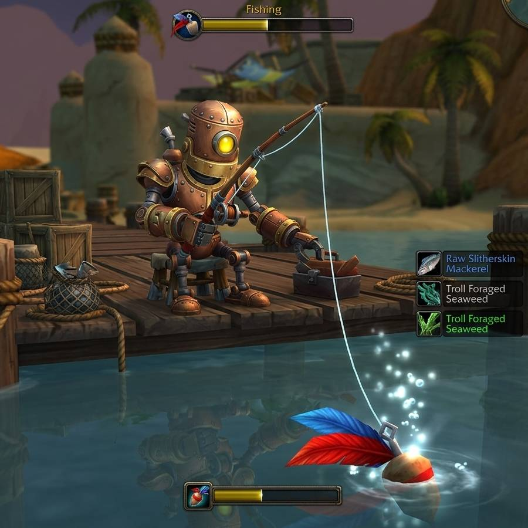

[Локальная настройка под пробел и запуск](LOCAL.md)

<h1>WoW Fishing Forever</h1>

<strong>A fishing bot for WoW</strong>

  
  
  

  <a href="#install"><b>Install</b></a>
  &nbsp;·&nbsp;
  <a href="#go-fish"><b>Go Fish</b></a>
  &nbsp;·&nbsp;
  <a href="#commands"><b>Commands</b></a>
  &nbsp;·&nbsp;
  <a href="#how-it-works"><b>How It Works</b></a>
  &nbsp;·&nbsp;
  <a href="#license"><b>License</b></a>

A fishing bot for **World of Warcraft: Forever**, successor to the 2019
[wow-fishing-bot](https://github.com/rsamf/wow-fishing-forever/tree/60d0710), now with many improvements, so you can now fish *forever*. It watches the
game window for the native Fishing / Рыболовля cast bar, listens to the game's own splash
sound for the bite, and presses your Interact key. Local BAR 4.2 setup and timings are documented in [LOCAL.md](LOCAL.md).

> [!NOTE]
> 🎉 **Announcement** This was my very first Python project but, surprisingly, my most popular repo on GitHub. 
> When I originally released this for WoW Classic, I had no idea it would get this much attention. I left this
> project unmaintained for 7 years, but I felt it was time for a return when I saw WoW Forever coming. I have 
> come back to make many major improvements to the bot and its accessibility. The original bot was only suited 
> for programmers, but now, I've designed it to be accessible to anyone by releasing GUI executables. Enjoy but 
> understand the risk you're taking!

## Install

### Download an executable (easy, but not recommended)

> [!CAUTION]
> Blizzard uses Warden, an anti-cheat program running alonside World of Warcraft. Warden is known
> to scan for open window titles or process names. They can discover this project and ban "wowfish*".
> Thus, it is recommended that you clone, rename the window title and process, and run the python, itself.

Grab the file for your OS from the
[latest release](https://github.com/rsamf/wow-fishing-forever/releases/latest):

| OS | file |
|---|---|
| Windows 10/11 (x86_64) | `wowfish-<version>-windows-x86_64.exe` |
| macOS (Apple Silicon) | `wowfish-<version>-macos-arm64` |
| Linux (x86_64) | `wowfish-<version>-linux-x86_64` |

The executables are not code-signed, so the first launch needs one extra step:

- **Windows:** SmartScreen shows "Windows protected your PC". Click *More info*, then
  *Run anyway*.
- **macOS:** Gatekeeper blocks it. Run `xattr -d com.apple.quarantine wowfish-*` in Terminal
  once, and `chmod +x wowfish-*` if needed. Intel Macs: use the developer install below.
- **Linux:** `chmod +x wowfish-*`.

Verify downloads against `SHA256SUMS.txt` from the same release.

### Run from source

Clone and run in place:

    git clone https://github.com/rsamf/wow-fishing-forever
    cd wow-fishing-forever
    uv sync --group dev
    uv run wowfish doctor

### Additional step for Mac users

Mac users need to install a virtual loopback device such as [BlackHole](https://existential.audio/blackhole/), route the game's audio through it, and pick it on the Setup tab (this sets `audio.capture = "device"`).

## Go Fish

> [!CAUTION]
> **Use at your own risk.** Automating gameplay violates Blizzard's terms of service and can
> get your account banned. This project exists for educational purposes only.

In the game:

1. *Options > Gameplay > Controls*: enable **Auto Loot**.
2. *Options > Keybindings > Targeting*: bind **Interact With Target**. wowfish assumes `f`.
3. Put **Fishing** on an action bar key. wowfish assumes `1`.
4. Keep the native fishing cast bar visible. The working loop does not require the gold gear icon.
5. *Options > Sound*: set **Ambience** and **Music** to 0 and keep **Sound Effects** up.

**Note to Linux users**: The first synthetic key press opens a "Remote Desktop" dialog. Switch on *Allow Remote Interaction* and click *Share*. Until you do, key presses are silently dropped.

**Note to Windows users**: You may need to run the program in admin mode.

Stand at the water and run the GUI:

    wowfish gui          # or double-click wowfish-gui

Or run it from terminal:

    wowfish doctor                      # checks the compatibility with this machine
    wowfish config                      # creates the config file; edit cast_key / interact_key
    wowfish run                         # observes the fishing bar; Ctrl-C stops

While the bot is running, keep the water in view and the game client in focus.

## Commands

| command | what it does |
|---|---|
| `wowfish gui` | The setup and fishing window |
| `wowfish run [--minutes N] [--record-audio WAV]` | Fish from the terminal until Ctrl-C or the session limit; optionally save everything heard |
| `wowfish doctor` | Check OS, display, OpenCV, audio devices, game window, input, calibration, config |
| `wowfish calibrate SHOT.png [--save]` | Measure the interact icon's on-screen size from a screenshot |
| `wowfish watch --live` | Show what the matcher sees: phase, score, position, milliseconds per frame |
| `wowfish watch --from DIR` | Same, over saved frames; `--save-frames` writes annotated thumbnails |
| `wowfish listen [--list] [--device D] [--record WAV]` | Meter the game's audio (or loopback device D), print bites as they are heard |
| `wowfish verify-bite WAV [--save]` | Score a recording against every splash clip and pick the bite |
| `wowfish config` | Create the config file if needed and print the resolved settings |
| `wowfish config --path` | Print only the config file location |
| `wowfish --version` | Print the version |

Add `--verbose` before any command for debug logging. `doctor` prints the log file path.

## How It Works

The local BAR 4.2 loop reads screen pixels and process audio, then sends the configured keys.
It does not read game memory or inject code. The local Space profile uses the existing
Forever Fishing key binding; it does not install or modify the addon.

1. **Observe:** identify the full native fishing bar and its RU/EN label, including near-empty fill.
2. **Listen:** while the bar is visible, recognize a splash and recheck the current cast before Interact.
3. **Recover:** after observed absence, recast; after a hook, use a shorter confirmation delay.
   Manual casts cancel pending automatic actions. WASD and focus checks guard every key press.

Timing, controls, limitations and validation are maintained in [LOCAL.md](LOCAL.md).
The standalone `calibrate` and `watch` commands remain available as optional icon diagnostics.

## License

MIT. See [LICENSE](LICENSE).
